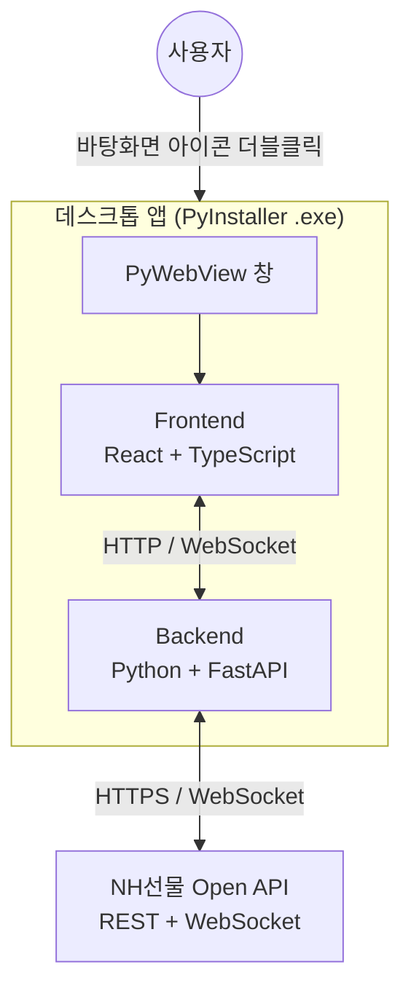

# NH FUTURES API

NH선물 Open API 로 국내·해외 선물/옵션의 시세 조회, 계좌 조회, 주문 실행을 하나의 데스크톱 앱에서 하는 오픈소스 프로젝트입니다.

Python 백엔드가 NH선물 Open API 와 통신하고, React 화면이 그 결과를 보여 줍니다. 최종 결과물은 바탕화면 아이콘을 더블클릭하면 실행되는 단일 실행 파일입니다.

---

## 목차

- [이용 시 유의사항](#이용-시-유의사항)
- [시작하기](#시작하기)
- [실행이 되지 않을 때](#실행이-되지-않을-때)
- [개발](#개발)
- [프로젝트 구조](#프로젝트-구조)
- [설정 파일](#설정-파일)
- [주요 기능](#주요-기능)
- [기술 스택과 아키텍처](#기술-스택과-아키텍처)

---

## 이용 시 유의사항

- 실제 거래에 쓰기 전에 반드시 **모의환경에서 충분히 시험**해 주세요.
- 이 코드로 만든 프로그램의 동작과 거래 결과에 대한 최종 확인과 책임은 사용자에게 있습니다.
- 실행 파일은 로컬에서 백엔드를 함께 띄우므로 방화벽·백신 프로그램이 접근을 막을 수 있습니다. 필요하면 예외로 등록해 주세요.

---

## 시작하기

### 1. NH선물 Open API 신청

1. 모의거래를 신청하고 모의계좌를 개설합니다.
2. 리얼 HTS 의 **[6128] REST API 신청** 화면에서 이용할 계좌를 골라 API 를 신청합니다.
3. 신청이 끝나면 **APP Key** 와 **APP Secret Key** 발급을 확인합니다(카카오톡 알림).

**APP Key 와 APP Secret Key 는 국내와 해외가 따로 발급됩니다.** 모의환경과 운영환경의 인증 정보도 구분해서 쓰세요. 키는 설치 중에 묻지 않고, 프로그램을 처음 켤 때 설정 화면에서 넣습니다.

[👉 NH선물 Open API 신청 및 설정 안내](https://apidev.futures.co.kr/#/)

### 2. Windows 에 설치하기

**`NH FUTURES API Setup.exe`** 는 필요한 도구와 의존성을 대신 설치해 주는 원클릭 설치 도우미입니다. Windows 10/11 에서 쓰며, 실행하는 데 Python·Node.js·Git 은 필요하지 않습니다.

| 설치하는 것 | 내용 |
| --- | --- |
| 개발 도구 | Node.js 22.15.0 이상, uv, just(없거나 오래된 것만) |
| 프로젝트 의존성 | Python 환경과 백엔드 패키지(uv), 프론트엔드 패키지(npm) |
| 앱 실행 파일 | 선택하면 `desktop/dist/NH FUTURES API.exe` 를 만듭니다 |
| 바탕화면 바로가기 | 실행 파일을 만든 경우 선택에 따라 만듭니다 |

1. 이 페이지 위의 초록색 **Code** 버튼에서 **Download ZIP** 을 고릅니다. [내려받기 링크](https://github.com/PetterChanHyuk/nh-futures-open-api/archive/refs/heads/main.zip)로 바로 받아도 됩니다.
2. ZIP 의 **압축을 모두 풀고** 프로젝트 폴더를 엽니다. 압축 파일 안에서 EXE 만 실행하지 마세요.
3. 폴더 안의 **`NH FUTURES API Setup.exe`** 를 더블클릭합니다.
4. **다음**으로 설치 위치와 옵션을 확인하고 **설치 시작**을 누릅니다. 진행 상태와 상세 로그가 창에 보입니다.
5. 끝나면 **실행하기**를 누릅니다. 실행 파일을 만들지 않았다면 **닫기**로 마치고 [개발 모드](#개발-모드)로 실행하세요.

설치 도우미의 동작과 제약은 [설치 도우미 문서](docs/windows-setup.md)에 있습니다.

#### 설치 도우미 없이 설치하기

PowerShell 5.1 이상과 winget 이 필요합니다. winget 이 없으면 Microsoft Store 의 **앱 설치 관리자**를 먼저 설치하세요. 압축을 푼 폴더의 주소 표시줄에 `powershell` 을 입력해 창을 열고 아래를 실행합니다.

```powershell
.\scripts\bootstrap.ps1
```

`이 시스템에서 스크립트를 실행할 수 없으므로` 라는 메시지가 나오면, 신뢰할 수 있는 소스인지 확인한 뒤 아래로 다시 실행하세요. 새로 띄운 PowerShell 에만 적용되고 PC 의 실행 정책은 바꾸지 않습니다.

```powershell
powershell -NoProfile -ExecutionPolicy Bypass -File .\scripts\bootstrap.ps1
```

Python 은 따로 설치하지 않아도 됩니다. uv 가 필요한 버전을 직접 준비합니다. 스크립트의 단계와 옵션은 [설치 스크립트 옵션](docs/development.md#설치-스크립트-옵션)에 있습니다.

### 3. macOS / Linux 에 설치하기

설치 도우미와 `bootstrap.ps1` 은 Windows 용입니다. macOS / Linux 에는 실행 파일 패키징과 원클릭 설치가 없고, 아래처럼 개발 환경을 직접 준비합니다.

[소스 ZIP](https://github.com/PetterChanHyuk/nh-futures-open-api/archive/refs/heads/main.zip)을 풀거나 `git clone https://github.com/PetterChanHyuk/nh-futures-open-api.git` 으로 받은 뒤, 터미널에서 `justfile` 이 있는 폴더로 이동합니다. Node.js 는 **22.15.0 이상**이어야 합니다 — 운영체제의 인증서 저장소를 쓰는 `NODE_OPTIONS=--use-system-ca` 가 22.15 부터 있기 때문입니다.

```bash
# uv (Python 버전과 의존성을 관리합니다)
curl -LsSf https://astral.sh/uv/install.sh | sh

# Node.js 22.15.0 이상 — https://nodejs.org 에서 조건을 만족하는 LTS 설치(npm 포함)

# just (태스크 러너)
brew install just                                                                             # macOS
curl --proto '=https' --tlsv1.2 -sSf https://just.systems/install.sh | bash -s -- --to ~/bin  # Linux

# 설치 확인과 구성 요소 준비
uv --version && node --version && just --version
just setup
```

macOS 의 `brew` 는 Homebrew 가 설치된 환경을 전제로 합니다. Linux 에서 just 를 `~/bin` 에 설치했다면 그 경로가 `PATH` 에 있어야 합니다. 준비가 끝나면 `just dev` 를 실행하고 **http://localhost:5173** 에 접속합니다.

### 4. 처음 실행하기

Windows 에서 실행 파일을 만들었다면 바탕화면의 **NH FUTURES API** 아이콘, 또는 `desktop\dist\NH FUTURES API.exe` 를 더블클릭합니다. 실행 파일을 만들지 않았거나 macOS / Linux 라면 [개발 모드](#개발-모드)로 실행합니다.

**지금 접속하는 환경에 인증 정보가 하나도 없으면, 켤 때 설정 화면이 자동으로 열립니다.** 국내·해외 중 한 시장만 채워도 시작할 수 있습니다.

1. **인증 정보** 탭에서 이용할 환경(모의투자 / 실전투자)과 시장(국내 / 해외)의 **APP Key**, **APP Secret Key** 를 넣습니다. 쓰지 않는 칸은 비워 둡니다. 비워 둔 시장은 계좌·일반주문 화면에서 그 시장을 고를 때 인증 정보가 없다고 알려 줍니다.
2. **저장**을 누르면 그 값으로 접속을 한 번 확인하고 결과를 보여 줍니다.
3. 모의투자와 실전투자 중 어디로 접속할지는 **일반** 탭에서 바꿉니다. 처음에는 모의투자입니다.

설정은 언제든 오른쪽 위 **⚙ 설정**에서 바꿉니다. 입력한 값은 사용자 홈의 [설정 파일](#설정-파일)에만 저장되고, 화면에는 가려서 보입니다. 바꾸려는 칸만 다시 입력하면 됩니다.

---

## 실행이 되지 않을 때

| 증상 | 조치 |
| --- | --- |
| 설치 도우미 EXE 가 없습니다 | 이전 버전 ZIP 일 수 있습니다. [최신 ZIP](https://github.com/PetterChanHyuk/nh-futures-open-api/archive/refs/heads/main.zip)을 다시 받거나 [설치 도우미 없이 설치하기](#설치-도우미-없이-설치하기)를 따르세요 |
| 설치 도우미가 프로젝트 파일을 찾지 못합니다 | ZIP 의 압축을 모두 풀고, 소스와 같은 폴더의 EXE 를 실행하세요 |
| 설치 창에 실패로 표시됩니다 | 상세 로그의 마지막 오류를 보고 네트워크·권한·도구 버전 문제를 해결한 뒤 다시 시도하세요 |
| `이 시스템에서 스크립트를 실행할 수 없으므로` 가 나옵니다 | [설치 도우미 없이 설치하기](#설치-도우미-없이-설치하기)의 실행 정책 명령을 쓰세요. 회사 그룹 정책 제한은 관리자에게 문의하세요 |
| 설치를 마쳤는데 명령을 찾지 못합니다 | PowerShell 창을 새로 여세요. 그래도 같으면 로그아웃 후 다시 로그인하세요 |
| `.\scripts\bootstrap.ps1` 을 찾을 수 없습니다 | 압축을 푼 폴더에서 PowerShell 을 다시 여세요 |
| 방화벽·백신 프로그램이 경고합니다 | 프로그램이 내부 연결을 씁니다. 예외로 등록하세요 |
| 켤 때 설정 화면이 열립니다 | 지금 접속하는 환경에 인증 정보가 없습니다. 그 환경의 APP Key 와 APP Secret Key 를 넣으세요 |
| 인증 확인에 실패합니다 | 모의투자 키를 실전투자 칸에 넣었거나 그 반대일 수 있습니다. 환경과 시장을 확인하세요 |

---

## 개발

### 명령 목록

모든 명령은 `just` 로 실행합니다. `just` 만 입력하면 목록이 나옵니다.

| 명령 | 내용 |
| --- | --- |
| `just setup` | 백엔드(`uv sync`)와 프론트엔드(`npm install`) 의존성 설치 |
| `just dev` | 백엔드(8000)와 프론트엔드(5173)를 함께 hot reload 로 실행 |
| `just typecheck` | 프론트엔드 타입 검사 |
| `just lint` | 코드 검사 — 백엔드(ruff), 프론트엔드(eslint) |
| `just test` | 백엔드 테스트 실행 |
| `just build` | 프론트엔드를 `backend/static/` 으로 빌드 |
| `just package` | 빌드 후 실행 파일 생성 → `desktop/dist/NH FUTURES API.exe` |

### 개발 모드

```bash
just dev
```

백엔드와 프론트엔드가 함께 뜹니다. **개발 중에는 http://localhost:5173 을 쓰세요.** `/api` 요청은 개발 서버가 백엔드로 넘기므로 이 주소 하나면 됩니다.

http://127.0.0.1:8000 은 `just build` 로 만든 이전 빌드 결과를 보여 주고 hot reload 가 되지 않습니다. 일반 모드와의 차이는 [개발 모드 비교](docs/development.md#개발-모드)에 있습니다.

> Windows 에서는 이미 쓰는 포트에도 바인딩이 성공합니다. `just dev` 를 다시 켰는데 고친 코드가 반영되지 않으면 이전 서버가 남아 있는지 `netstat -ano | findstr :8000` 으로 확인하세요.

### 저장해 둔 응답으로 실행하기

NH선물 서버에 접속할 수 없는 곳에서 화면을 확인할 때 쓰는 개발용 방식입니다. 환경 변수 `NH_REPLAY` 를 켜면 서버 대신 `tests/fixtures/nh/` 의 저장해 둔 응답으로 답하고, `/api/health` 의 `mode` 가 `replay` 가 됩니다. 화면의 값은 실제 시세나 잔고가 아닙니다.

```bat
set NH_REPLAY=1
just dev
```

PowerShell 에서는 첫 줄을 `$env:NH_REPLAY = "1"` 로 씁니다.

달라지는 동작과 저장해 둔 응답을 만드는 법은 [저장해 둔 응답으로 실행하기](docs/development.md#저장해-둔-응답으로-실행하기)에 있습니다.

### 지켜야 할 규칙 둘

**1) 백엔드 주소는 `/api` 아래에 만듭니다.** `/` 는 화면 파일이 차지하므로 그 밖에 만들면 배포 상태에서 가려집니다.

**2) 화면에서 백엔드를 부를 때는 경로만 적습니다.** 배포 상태에서는 실행할 때마다 포트가 달라질 수 있습니다.

```ts
fetch("/api/health"); // 이렇게

fetch("http://127.0.0.1:8000/api/health"); // 이렇게 하지 마세요
```

무엇을 고치려면 어느 파일을 보는지는 [어디를 고치면 되나요](docs/development.md#어디를-고치면-되나요)에 있습니다.

---

## 프로젝트 구조

```
nh-futures-open-api/
├── NH FUTURES API Setup.exe      # Windows 설치 도우미 (Download ZIP 에 포함)
├── backend/                      # Python 백엔드 — FastAPI 서버 + NH선물 API 래퍼
│   ├── main.py                       # 진입점. 기능별 라우터를 /api 아래에 붙이고 화면 정적 파일 서빙
│   ├── config.py                     # 설정 파일 읽기·저장 (사용자 홈의 config.yaml)
│   ├── storage.py                    # 상태 파일 읽기·쓰기 공통 (깨진 파일 처리, 재생 표지)
│   ├── auth/                         # 접속 토큰 발급·갱신·폐기, 웹소켓 접속키
│   ├── nh_api/                       # 거래 API 공통 호출부 — API 목록, 호출 제한, 재생 모드
│   ├── master/                       # 종목 마스터 — 시작 시 내려받기·파싱·색인
│   ├── domestic_futureoption/        # 국내 선물·옵션 API 함수와 마스터 레이아웃
│   ├── overseas_futureoption/        # 해외 선물·옵션 API 함수와 마스터 레이아웃
│   ├── quotes.py, orders.py          # 시세·주문 응답을 두 시장 공통 모양으로 맞추는 규칙
│   ├── realtime/                     # 실시간 시세 허브 (웹소켓 구독·방송)
│   ├── sessions/                     # 장 시간·세션 판정
│   ├── strategy/                     # 전략주문 — 규칙·엔진·종이 장부·모의 계좌·기록·분석 조회
│   ├── ui/                           # 화면 배치·관심 종목 저장
│   └── static/                       # just build 산출물 (저장소에 포함되지 않음)
├── frontend/src/                 # React + TypeScript UI
│   ├── app/                          # 상단 바, 사이드바, 설정 모달, 종목 검색 등 공통 골격
│   ├── screens/                      # 화면 — home, instruments, trade, account, strategy, settings
│   ├── lib/                          # 숫자 표기, 조회 상태, 스파크라인 등 공용 코드
│   ├── data/                         # 서버 호출과 화면 저장소 — 시세·주문·계좌·전략·기록 조회
│   └── assets/                       # CI 마크
├── desktop/main.py               # 데스크톱 앱 진입점 — 백엔드를 스레드로 띄우고 창 표시
├── build/                        # PyInstaller 설정과 아이콘
├── docs/                         # 설치 도우미 문서, 개발 안내 상세
├── scripts/
│   ├── bootstrap.ps1                 # Windows 설치 스크립트
│   ├── setup/                        # Windows GUI 설치 도우미 소스와 오프라인 테스트
│   ├── build-setup.ps1               # 설치 EXE 와 소스 배포 ZIP 생성 (배포 담당자용)
│   ├── test-setup.ps1                # 실제 설치 없이 설치 도우미 검증
│   ├── compare-setup.ps1             # 설치 도우미 산출물 비교
│   ├── check_identifiers.py          # 코드 식별자 규칙 검사
│   └── import_nh_fixtures.py         # 수집한 응답을 테스트용 자료로 반입
├── tests/                        # pytest
│   ├── fixtures/nh/                  # 저장해 둔 NH선물 Open API 응답
│   └── fixtures/master/              # 시험용 종목 마스터
├── config.example.yaml           # 설정 파일 서식 (실제 설정은 ~/NHFutures/config/config.yaml)
├── justfile                      # 태스크 러너 명령 정의
└── pyproject.toml                # Python 의존성과 코드 검사 설정 (uv, ruff)
```

시세·주문 라우트는 각 카테고리 폴더의 `*_routes.py` 에 있습니다.

---

## 설정 파일

설정 화면에서 저장하면 아래 경로에 만들어집니다. 직접 열어 고쳐도 됩니다.

| 운영체제 | 경로 |
| --- | --- |
| Windows | `C:\Users\{사용자 이름}\NHFutures\config\config.yaml` |
| macOS / Linux | `~/NHFutures/config/config.yaml` |

**환경**(모의/실전) 아래에 **시장**(국내/해외)별로 인증 정보를 넣는 구조입니다. 쓰지 않는 환경이나 시장은 비워 둡니다.

```yaml
default_environment: paper # 프로그램을 켤 때 접속할 환경

paper: # 모의투자
  base_url: "" # 접속 주소. 비워 두면 기본값을 씁니다
  domestic: # 국내 선물/옵션
    app_key: ""
    app_secret: ""
  overseas: # 해외 선물/옵션
    app_key: ""
    app_secret: ""

real: # 실전투자 — 구조는 paper 와 같습니다
  base_url: ""
  domestic: { ... }
  overseas: { ... }
```

`default_environment` 는 프로그램 안에서 환경을 바꾸면 함께 바뀌어, 다음에 켤 때 마지막에 쓰던 환경으로 섭니다. 저장소의 `config.example.yaml` 이 같은 구조의 빈 템플릿입니다. **실제 값이 든 설정 파일을 프로젝트 폴더 안에 두지 마세요.**

프로그램은 `~/NHFutures/` 아래에 설정(`config/`)과 함께 종목 마스터(`master/`)와 화면·전략 상태(`state/`)를 남깁니다. **`config` 폴더는 누구에게도 보내지 마세요.** 파일별 내용은 [프로그램이 사용자 폴더에 남기는 것](docs/development.md#프로그램이-사용자-폴더에-남기는-것)에 있습니다.

---

## 주요 기능

아래 홈·일반주문 그림의 계좌 값은 모의투자 계좌의 값입니다. 전략 설정 그림은 [저장해 둔 응답](#저장해-둔-응답으로-실행하기)으로 띄운 화면입니다.

### 인증

- APP Key / APP Secret 으로 접속 토큰 발급(REST / WebSocket 각각)과 자동 갱신
- 모의환경 / 운영환경 구분 접속

### 시세 및 조회

**홈** — 국내·해외 계좌 요약, 주문 내역, 관심종목 시세를 한 화면에 모읍니다.


- 국내 선물·옵션 시세(REST / WebSocket) — 주간·야간 세션을 자동으로 판정하고, 야간에는 야간 현재가와 월물별 야간 시세를 보입니다
- 해외 선물·옵션 시세(거래소별 REST / WebSocket)
- 스프레드 종목의 시세·차트(가격이 음수로 오는 종목도 그대로 보입니다)
- 계좌 조회 — 예수금, 잔고, 미체결, 체결, 주문 오류 내역과 추이
- 종목 화면 — 받아 둔 종목 마스터로 국내·해외 상품과 월물을 시장·거래소·선물/옵션별로 찾아봅니다. 옵션 월물을 누르면 옵션 체인이 열립니다

### 주문

**일반주문** — 차트, 호가, 시세체결, 주문 폼, 주문체결상세를 한 화면에서 봅니다.


- 국내·해외 선물·옵션 주문과 응답 확인, 미체결 주문의 정정·취소
- 국내 스프레드 종목은 주문할 수 있습니다. 해외 스프레드 종목은 보기만 하고 주문할 수 없습니다

> **주문은 지금 접속해 있는 환경으로 나갑니다.** 실전투자로 두고 주문을 내면 실제 주문이 접수됩니다. 접속 환경은 **⚙ 설정 → 일반** 탭에서 바꾸고, 처음에는 모의투자입니다. 화면에 표시된 환경과 서버가 실제로 접속한 환경이 다르거나 아직 확인되지 않았으면 주문을 보내지 않고 알립니다.

### 전략주문

**전략 설정 편집기** — 진입·청산 규칙을 단계와 조건으로 적고, 오른쪽에서 문장으로 다시 읽어 확인합니다.


- **전략 설정** — 매수·매도 진입과 청산 규칙을 단계와 조건으로 적습니다. 조건 값은 가격·지표(이동평균, RSI, ATR, 볼린저 밴드, 거래량)·호가·봉 시각·보유 수량과 평가손익입니다. 단계 사이 유효기간, 시간 초과 초기화, 방향별 주문 가격 기준, 손절·익절·추적 청산, 하루 손실·연속 손실 한도를 둘 수 있고, 저장할 수 없는 값은 칸 아래에 미리 알립니다
- **전략 검증** — 앱 안의 시뮬레이션 장부로 실제 시세에 규칙을 돌려 체결·손익을 봅니다. 차트의 체결 표지를 누르면 체결 이유·수수료·체결 당시 지표 값이 보입니다
- **전략 진행** — **계좌로 실제 주문이 나가는** 실행입니다. 모의 계좌와 실전 계좌 두 갈래가 있고, 지금 접속한 환경과 같은 갈래만 세울 수 있습니다. 어느 갈래든 확인창에서 승인해야 시작됩니다. 여러 실행을 함께 중지·청산·종료할 수 있고, 체결 줄에 계좌 주문번호가 남습니다
- **전략 분석** — 기록에서 기간·시장·전략·종목으로 걸러 누적 곡선, 버전 비교, 거래 내역, 체결 품질을 봅니다

> 전략 진행의 주문은 지금 접속한 환경의 계좌로 실제 접수됩니다. 실전투자로 접속해 있으면 실전 계좌로 나갑니다.

### 데스크톱 애플리케이션

- 바탕화면 아이콘 더블클릭으로 실행되는 단일 실행 파일
- 백엔드 엔진과 화면이 하나의 프로세스로 함께 동작

---

## 기술 스택과 아키텍처

| 영역 | 항목 | 역할 |
| --- | --- | --- |
| 백엔드 | Python 3.11+ | 언어 및 런타임 |
| 백엔드 | FastAPI | HTTP API 및 WebSocket 서버 |
| 백엔드 | uv | Python 버전 · 의존성 · 가상 환경 관리 |
| 프론트엔드 | React | UI 라이브러리 |
| 프론트엔드 | TypeScript | 정적 타입 언어 |
| 프론트엔드 | Vite | 개발 서버 및 번들러 |
| 프론트엔드 | npm | Node.js 패키지 관리자 |
| 프론트엔드 | KLineChart | 캔들 차트와 보조지표 |
| 개발 환경 | Node.js 22.15.0+ | 프론트엔드 개발·빌드 및 npm 실행(운영체제 공통) |
| 데스크톱 패키징 | PyWebView | 시스템 웹뷰 기반 창 표시 |
| 데스크톱 패키징 | PyInstaller | 단일 실행 파일 빌드 |
| 태스크 러너 | just | 설치 / 개발 / 빌드 / 패키징 명령 통합 |


