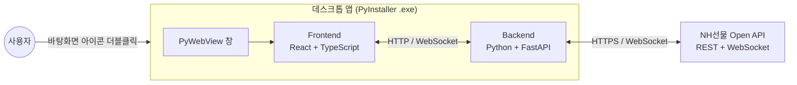

# NH FUTURES API

NH선물 Open API를 활용하여 국내·해외 선물/옵션의 시세 조회, 계좌 조회, 주문 실행 등 트레이딩에 필요한 기능을 하나의 데스크톱 애플리케이션으로 제공하는 오픈소스 프로젝트입니다.

Python 기반 백엔드 엔진이 NH선물 Open API와 연동하고, React 기반 UI가 이를 시각적으로 표현합니다. 최종 결과물은 바탕화면에서 아이콘 더블클릭 한 번으로 실행 가능한 데스크톱 앱 형태로 배포됩니다.

---

## 목차

**이용 안내**

- [이용 시 유의사항](#이용-시-유의사항)
- [NH선물 Open API 신청](#nh선물-open-api-신청)
- [원클릭 설치 가이드 (Windows용)](#원클릭-설치-가이드-windows용)
- [Windows 수동 설치 및 문제 해결](#windows-수동-설치-및-문제-해결)
- [macOS / Linux 수동 설치 가이드](#macos--linux-수동-설치-가이드)
- [처음 실행하기](#처음-실행하기)
- [설정 바꾸기](#설정-바꾸기)
- [실행이 되지 않을 때](#실행이-되지-않을-때)

**개발 안내**

- [개발 모드](#개발-모드)
- [프로젝트 구조](#프로젝트-구조)
- [어디를 고치면 되나요](#어디를-고치면-되나요)
- [명령 목록](#명령-목록)
- [설정 파일](#설정-파일)

**참고**

- [주요 기능](#주요-기능)
- [기술 스택](#기술-스택)
- [아키텍처](#아키텍처)

---

## 이용 시 유의사항

- 본 프로젝트는 NH선물 Open API 연동 및 트레이딩 애플리케이션 개발을 지원하기 위한 오픈소스 프로젝트입니다.
- 프로젝트 구성 및 기능은 서비스 개선에 따라 변경되거나 업데이트될 수 있습니다.
- 실제 거래에 적용하기 전 반드시 모의환경을 통한 충분한 테스트를 권장합니다.
- 본 프로젝트의 코드를 활용하여 개발·실행한 프로그램의 동작 및 거래 결과에 대한 최종 확인과 책임은 사용자에게 있습니다.
- 데스크톱 앱 형태로 배포되는 실행 파일은 로컬 환경에 백엔드 프로세스를 함께 실행하므로, 방화벽 및 백신 프로그램에 의해 접근이 제어될 수 있습니다. 필요 시 예외 등록 후 사용해 주세요.

---

## NH선물 Open API 신청

NH선물 Open API 이용 전 모의거래 신청 및 모의계좌 개설이 필요합니다.

1. **모의거래 신청 및 모의계좌 개설**
2. 리얼 HTS의 **[6128] REST API 신청** 화면에서 이용할 계좌를 선택하여 API 신청
3. 신청 완료 후 **APP Key** 및 **APP Secret Key** 발급 확인(카카오톡 알림)
4. 발급받은 **APP Key**와 **APP Secret Key**는 프로그램을 처음 켤 때 나오는 설정 화면에서 입력합니다. 설치 중에는 묻지 않습니다.

**APP Key와 APP Secret Key는 국내와 해외가 각각 별도로 발급됩니다.** 이용하실 시장의 인증 정보를 준비해 주세요.

모의환경과 운영환경의 인증정보 및 접속 환경은 반드시 구분하여 이용해 주세요.

[👉 NH선물 Open API 신청 및 설정 안내](https://apidev.futures.co.kr/#/)

---

## 원클릭 설치 가이드 (Windows용)

macOS / Linux 사용자는 [수동 설치 가이드](#macos--linux-수동-설치-가이드)를 참고해 주세요. Windows용 설치 EXE는 Mac에서 실행할 수 없습니다.

**`NH FUTURES API Setup.exe`** 는 이 프로그램을 돌리는 데 필요한 것을 대신 설치해 주는 **원클릭 설치 도우미**입니다. Windows 10/11 에서 더블클릭 한 번으로 아래를 준비합니다. 설치 도우미를 실행하는 데 Python·Node.js·Git 은 필요하지 않습니다.

| 설치하는 것 | 내용 |
| --- | --- |
| 개발 도구 | Node.js 22.15.0 이상, uv, just (없거나 오래된 것만 설치) |
| 프로젝트 의존성 | Python 환경과 백엔드 패키지(uv), 프론트엔드 패키지(npm) |
| 앱 실행 파일 | 선택하면 화면을 빌드해 `desktop/dist/NH FUTURES API.exe` 생성 |
| 바탕화면 바로가기 | 앱 실행 파일을 만든 경우 선택에 따라 생성 |

APP Key 와 Secret Key 는 설치 도우미에서 받지 않고, 앱을 실행한 뒤 설정 화면에서 입력합니다.

### 설치 순서

1. 이 페이지 상단의 초록색 **Code** 버튼을 누르고 **Download ZIP** 을 선택합니다. 또는 [내려받기 링크](https://github.com/PetterChanHyuk/nh-futures-open-api/archive/refs/heads/main.zip)를 눌러 바로 받으셔도 됩니다. 설치 도우미가 함께 들어 있습니다.
2. ZIP 의 **압축을 모두 풀고** 프로젝트 폴더를 엽니다. 압축 파일 안에서 EXE 만 실행하지 마세요.
3. 폴더 안의 **`NH FUTURES API Setup.exe`** 를 더블클릭합니다.
4. **다음**으로 설치 위치와 옵션을 확인한 뒤, 설치 준비 화면에서 **설치 시작**을 누릅니다. 진행 상태와 상세 로그를 창에서 확인할 수 있습니다.
5. 끝나면 **실행하기**를 누릅니다. 프로그램이 시작되면 설치 창은 자동으로 닫힙니다. 실행 파일을 만들지 않았다면 **닫기**로 마치고 [개발 모드](#개발-모드)를 참고해 주세요.

설치 도우미의 동작 규칙과 제약은 [설치 도우미 문서](docs/windows-setup.md)에 있습니다.

---

## Windows 수동 설치 및 문제 해결

설치 도우미 EXE 를 쓰지 않거나 설치 도우미가 실패했을 때 쓰는 방법입니다. PowerShell 5.1 이상과 winget(Windows 패키지 관리자)이 필요합니다. winget이 없다면 Microsoft Store의 **앱 설치 관리자**를 먼저 설치해야 합니다. 회사 PC에서 설치가 제한되면 관리자에게 문의해 주세요.

macOS / Linux에서는 이 스크립트 대신 [수동 설치 가이드](#macos--linux-수동-설치-가이드)를 이용해 주세요.

### 1. 설치 파일 내려받기

1. 이 페이지 상단의 초록색 **Code** 버튼을 누르고 **Download ZIP** 을 선택합니다.
2. 또는 [내려받기 링크](https://github.com/PetterChanHyuk/nh-futures-open-api/archive/refs/heads/main.zip)를 눌러 바로 받으셔도 됩니다.

> Git을 쓰시는 분은 `git clone https://github.com/PetterChanHyuk/nh-futures-open-api.git` 으로 받으셔도 됩니다. 어느 방법으로 받으셔도 이후 과정은 같습니다.

### 2. PowerShell 열기

1. 파일 탐색기에서 내려받은 파일을 마우스 오른쪽 버튼으로 클릭하고 **압축 풀기** 를 선택합니다.
2. 압축이 풀린 폴더를 열고, 위쪽 **주소 표시줄**을 클릭합니다. 경로 글자가 선택됩니다.
3. 그 자리에 **powershell** 이라고 입력하고 **Enter** 를 누릅니다.
4. 검은색 또는 파란색 창이 열립니다. 이것이 PowerShell입니다.

> 폴더 빈 곳에서 **Shift 키를 누른 채 마우스 오른쪽 버튼**을 클릭한 뒤 `여기에 PowerShell 창 열기` 를 선택하셔도 됩니다.

### 3. 설치 명령 실행

열린 창에 아래를 입력하고 **Enter** 를 누릅니다.

```powershell
.\scripts\bootstrap.ps1
```

아래 순서로 설치가 진행됩니다. 요구 조건을 만족하는 도구는 재사용합니다. 다시 실행하면 의존성 설치는 다시 수행하고, 앱 EXE 생성 여부는 다시 묻습니다.

| 단계 | 내용                                              | 물어보는 것      |
| ---- | ------------------------------------------------- | ---------------- |
| 1    | 필요한 도구 설치 (Node.js 22.15.0 이상, uv, just) | 없음             |
| 2    | 구성 요소 준비                                    | 없음             |
| 3    | 실행 파일 만들기                                  | 있음 — 아래 참고 |

| 물어보는 것                             | 답             | 결과                                                  |
| --------------------------------------- | -------------- | ----------------------------------------------------- |
| 지금 실행 파일을 만들까요? `(Y/n)`      | Enter 또는 `y` | 1~2분 걸려 실행 파일을 만듭니다                       |
|                                         | `n`            | 건너뜁니다. 나중에 `just package` 로 만들 수 있습니다 |
| 바탕화면에 바로가기를 만들까요? `(Y/n)` | Enter 또는 `y` | 바탕화면에 **NH FUTURES API** 아이콘을 만듭니다               |
|                                         | `n`            | 만들지 않습니다                                       |

`(Y/n)` 은 **대문자가 기본값**이라는 뜻입니다. 그냥 **Enter** 를 누르면 `Y` 가 선택됩니다. 직접 개발하실 예정이라면 첫 질문에 `n` 을 누르셔도 됩니다.

> **Python은 따로 설치하지 않아도 됩니다.** uv가 필요한 버전을 직접 찾거나 내려받아 관리합니다.

### 실행 정책 오류가 나면

`이 시스템에서 스크립트를 실행할 수 없으므로`라는 메시지가 나온 경우, 신뢰할 수 있는 프로젝트 소스인지 확인한 뒤 같은 PowerShell 창에서 다음 명령을 실행하세요.

```powershell
powershell -NoProfile -ExecutionPolicy Bypass -File .\scripts\bootstrap.ps1
```

새로 실행한 PowerShell 프로세스에만 적용되며 PC 전체의 실행 정책은 변경하지 않습니다. 회사의 그룹 정책으로 실행이 제한되어 있다면 이 방법으로도 실행되지 않을 수 있습니다. 보안 설정을 계속 변경하지 말고 관리자에게 문의해 주세요. 다른 오류는 [실행이 되지 않을 때](#실행이-되지-않을-때)를 참고하세요.

---

## 처음 실행하기

Windows에서 앱 EXE와 바로가기를 생성했다면 바탕화면의 **NH FUTURES API** 아이콘을 더블클릭하시면 실행됩니다. 바로가기를 만들지 않으셨다면 압축을 푼 폴더 안의 `desktop\dist\NH FUTURES API.exe` 를 더블클릭하셔도 됩니다. 앱 EXE 생성을 건너뛰었거나 macOS / Linux를 이용한다면 [개발 모드](#개발-모드)로 실행해 주세요.

켤 때 **지금 접속하는 환경의 인증 정보가 하나도 없으면 설정 화면이 자동으로 열립니다.** 처음 켤 때가 그렇습니다. 국내·해외 중 한 시장만 채워도 시작할 수 있습니다.

1. **인증 정보** 탭에서 이용하실 환경(모의투자 / 실전투자)과 시장(국내 / 해외)의 **APP Key**, **APP Secret Key** 를 입력합니다. 이용하지 않는 환경이나 시장의 칸은 비워 두셔도 됩니다. 비워 둔 시장은 계좌·일반주문 화면에서 그 시장을 고를 때 인증 정보가 없다고 알려 줍니다.
2. **저장**을 누르면 입력한 값으로 접속을 한 번 확인하고 결과를 보여 줍니다.
3. 모의투자와 실전투자 중 어느 쪽으로 접속할지는 **일반** 탭에서 바꿉니다. 처음에는 모의투자입니다.

입력한 값은 사용자 홈 폴더의 설정 파일에만 저장됩니다. 화면에는 가려서 표시되고, 바꾸려는 칸만 다시 입력하면 됩니다.

---

## 설정 바꾸기

프로그램 오른쪽 위 **⚙ 설정**에서 모의/실전 전환과 인증 정보를 바꿀 수 있습니다.

설정 파일을 직접 열어 수정하셔도 됩니다. 위치는 아래와 같습니다.

```
C:\Users\{사용자 이름}\NHFutures\config\config.yaml
```

항목별 설명은 [설정 파일](#설정-파일)을 참고해 주세요.

---

## 실행이 되지 않을 때

| 증상                                                                 | 조치                                                                                                                                          |
| -------------------------------------------------------------------- | --------------------------------------------------------------------------------------------------------------------------------------------- |
| 설치 도우미 EXE가 없습니다 | 설치 도우미가 없는 이전 버전 ZIP일 수 있습니다. [최신 ZIP](https://github.com/PetterChanHyuk/nh-futures-open-api/archive/refs/heads/main.zip)을 다시 받아 압축을 모두 풀거나 [Windows 수동 설치](#windows-수동-설치-및-문제-해결)를 이용해 주세요 |
| 설치 도우미가 프로젝트 파일을 찾지 못합니다 | ZIP의 압축을 모두 풀고 소스와 함께 있는 `NH FUTURES API Setup.exe`를 실행하세요 |
| 설치 창에서 실패로 표시됩니다 | 상세 로그의 마지막 오류를 확인하세요. 네트워크·권한·도구 버전 문제를 해결한 뒤 다시 시도할 수 있습니다 |
| `이 시스템에서 스크립트를 실행할 수 없으므로` 라는 메시지가 나옵니다 | [실행 정책 오류 안내](#실행-정책-오류가-나면)를 따라 설치 프로세스에 한정해 다시 실행하세요. 회사의 그룹 정책 제한은 관리자에게 문의해 주세요 |
| 설치를 마쳤는데 명령을 찾지 못합니다                                 | PowerShell 창을 닫고 새로 열어 주세요. 그래도 같으면 로그아웃 후 다시 로그인해 주세요                                                         |
| `.\scripts\bootstrap.ps1` 을 찾을 수 없다고 나옵니다                 | PowerShell이 다른 폴더에서 열렸을 수 있습니다. 압축을 푼 폴더에서 다시 열어 주세요                                                            |
| 방화벽이나 백신 프로그램이 경고를 표시합니다                         | 프로그램이 내부적으로 연결을 사용합니다. 예외로 등록한 뒤 이용해 주세요                                                                       |
| 켤 때마다 설정 화면이 열립니다                                       | 인증 정보 탭에 빈 칸이 있습니다. 지금 이용하는 환경의 국내·해외 APP Key와 APP Secret Key를 모두 채워 주세요                                   |
| 인증 확인에 실패한다고 나옵니다                                      | 모의투자 키를 실전투자 칸에 넣었거나 그 반대일 수 있습니다. 환경과 시장이 맞는지 확인해 주세요                                                |

---

## 개발 모드

코드를 고치거나 기능을 직접 만드실 때 쓰는 실행 방식입니다.

먼저 운영체제에 맞게 [Windows 설치 안내](#원클릭-설치-가이드-windows용) 또는 [macOS / Linux 수동 설치](#macos--linux-수동-설치-가이드)를 따라 개발 도구와 의존성을 준비해 주세요. 준비가 끝나면 아래 명령으로 개발 모드를 실행할 수 있습니다. 코드 편집기는 별도로 준비해 주세요.

|               | 일반 모드                  | 개발 모드                |
| ------------- | -------------------------- | ------------------------ |
| 실행 방법     | 바탕화면 **NH FUTURES API** 아이콘 | `just dev`               |
| 접속          | 창이 바로 열립니다         | http://localhost:5173    |
| 화면을 고치면 | 다시 빌드해야 반영됩니다   | 저장하면 바로 반영됩니다 |
| 언제 쓰나요   | 프로그램을 이용할 때       | 코드를 고칠 때           |

```bash
just dev
```

백엔드와 프론트엔드가 함께 실행됩니다. 접속 주소가 두 개인데 **개발 중에는 프론트엔드 주소를 쓰셔야 합니다.**

|            | 주소                  |                                                    |
| ---------- | --------------------- | -------------------------------------------------- |
| 프론트엔드 | http://localhost:5173 | **개발 중에는 이쪽**                               |
| 백엔드     | http://127.0.0.1:8000 | 이전 빌드 결과가 보이고 hot reload가 되지 않습니다 |

`/api` 요청은 개발 서버가 백엔드로 전달하므로, 프론트엔드 주소 하나만 열어 두시면 됩니다.

> Windows에서는 이미 사용 중인 포트에도 바인딩이 성공합니다. `just dev` 를 다시 켰는데 고친 코드가 반영되지 않는 것처럼 보이면, 이전 서버가 남아 있는지 `netstat -ano | findstr :8000` 으로 확인해 주세요.

### 저장해 둔 응답으로 실행하기

NH선물 서버에 접속할 수 없는 곳에서 화면을 고치고 확인할 때 쓰는 **개발용** 방식입니다. 서버에 묻는 대신 `tests/fixtures/nh/` 에 저장해 둔 응답을 돌려줍니다. 기본값은 실서버이고 켤 때만 동작하며, 저장해 둔 응답은 실행 파일에 들어가지 않으므로 배포된 프로그램에는 이 방식이 없습니다.

```bash
set NH_REPLAY=1        # PowerShell 은 $env:NH_REPLAY = "1"
```

`/api/health` 의 `mode` 가 `replay` 이면 저장해 둔 응답으로 답하는 중입니다. **화면에 뜨는 값은 실제 시세나 잔고가 아닙니다.** 접속 토큰과 웹소켓 접속키는 그 자리에서 만들어 낸 값입니다. 날짜나 이어받기 키만 다른 요청에는 조회 조건이 같은 기록으로 답하고, 조회 조건(체결구분 같은 것)이 같은 기록이 없으면 다른 기록 대신 **0건으로** 답하며, 어느 쪽이든 그 사실을 응답 헤더 `x-nh-replay-match` 에 남깁니다. 주문은 저장해 둔 요청과 똑같을 때만 재생됩니다. 설정 화면의 인증 정보 저장은 이 방식에서는 거절됩니다 — 사용자 설정 파일을 건드리지 않습니다(모의·실전 전환은 됩니다). 종목 마스터도 받으러 나가지 않고 사용자 홈에 받아 둔 파일만 씁니다 — 받아 둔 것이 없으면 종목 목록이 비고, 「다시 받기」는 거절됩니다. 예수금과 잔고, 주문 내역은 모의 환경의 응답만 저장해 둡니다. **주문 오류 내역은 저장해 둔 응답이 없어 이 방식으로는 조회되지 않습니다.** 이 방식으로 띄우면 전략 실행·거래 기록·손실 한도·예수금 추이는 `~/NHFutures/state-replay/` 에 따로 쌓여 실서버로 띄운 상태와 섞이지 않습니다(전략 목록만 함께 씁니다).

저장해 둔 응답은 수집한 기록에서 반입합니다.

```bash
uv run python scripts/import_nh_fixtures.py --source <수집 폴더>
```

실전 환경의 계좌·주문 응답은 금액이 실제 값 그대로여서 **저장소에 올리지 않습니다.** 그 응답까지 두고 쓰려면 `--private-out` 으로 따로 반입합니다. 그 폴더는 `.gitignore` 에 들어 있어 커밋되지 않고, **없어도 프로그램과 테스트는 그대로 동작합니다.**

```bash
uv run python scripts/import_nh_fixtures.py --source <수집 폴더> --private-out tests/fixtures/nh_private
```

**저장소 안의 다른 폴더를 지정하지 마세요.** 반입 자리와 겹치면(같거나 한쪽이 다른 쪽 안이면) 실행이 거부되지만, 저장소 안 아무 곳이나 지정하면 그 금액이 커밋될 수 있습니다.

`NH_REPLAY_PRIVATE_DIR` 로 그 폴더를 다른 자리에서 읽거나(값에 경로), 아예 안 읽게(빈 값) 할 수 있습니다.

---

## 프로젝트 구조

```
nh-futures-open-api/
├── NH FUTURES API Setup.exe           # Windows 설치 도우미 (Download ZIP에 포함)
├── backend/                    # Python 백엔드 — FastAPI 서버 + NH선물 API 래퍼
│   ├── main.py                     # 진입점. 기능별 라우터를 /api 아래에 붙이고 화면 정적 파일 서빙
│   ├── config.py                   # 설정 파일 읽기·저장 (사용자 홈의 config.yaml)
│   ├── storage.py                  # 상태 파일 읽기·쓰기 공통 (깨진 파일 처리, 재생 표지)
│   ├── auth/                       # 접속 토큰 발급·갱신·폐기, 웹소켓 접속키
│   ├── nh_api/                     # 거래 API 공통 호출부 — API 목록, 호출 제한, 재생 모드
│   ├── master/                     # 종목 마스터 — 시작 시 내려받기·파싱·색인
│   ├── domestic_futureoption/      # 국내 선물·옵션 API 함수와 마스터 레이아웃
│   ├── overseas_futureoption/      # 해외 선물·옵션 API 함수와 마스터 레이아웃
│   ├── quotes.py, orders.py        # 시세·주문 응답을 두 시장 공통 모양으로 맞추는 규칙 (라우트는 각 카테고리 폴더의 *_routes.py)
│   ├── realtime/                   # 실시간 시세 허브 (웹소켓 구독·방송)
│   ├── sessions/                   # 장 시간·세션 판정
│   ├── strategy/                   # 전략주문 — 규칙·엔진·종이 장부·모의 계좌·기록·분석 조회
│   ├── ui/                         # 화면 배치·관심 종목 저장
│   └── static/                     # just build 산출물 (저장소에 포함되지 않음)
│
├── frontend/                   # React + TypeScript UI
│   └── src/
│       ├── app/                    # 상단 바, 사이드바, 설정 모달, 종목 검색 등 공통 골격
│       ├── screens/                # 화면 — home, instruments, trade, account, strategy, settings
│       ├── lib/                    # 숫자 표기, 조회 상태, 스파크라인 등 공용 코드
│       ├── data/                   # 서버 호출과 화면 저장소 — 시세·주문·계좌·전략·기록 조회
│       └── assets/                 # CI 마크
│
├── desktop/main.py             # 데스크톱 앱 진입점 — 백엔드를 스레드로 띄우고 창 표시
├── build/                      # PyInstaller 설정과 아이콘
├── docs/                       # 설치 도우미 문서
├── scripts/
│   ├── bootstrap.ps1               # Windows 설치 스크립트
│   ├── setup/                      # Windows GUI 설치 도우미 소스와 오프라인 테스트
│   ├── build-setup.ps1             # 설치 EXE와 소스 배포 ZIP 생성 (배포 담당자용)
│   ├── test-setup.ps1              # 실제 설치 없이 설치 도우미 검증
│   ├── compare-setup.ps1           # 설치 도우미 산출물 비교
│   ├── check_identifiers.py        # 코드 식별자 규칙 검사
│   └── import_nh_fixtures.py       # 수집한 응답을 테스트용 자료로 반입
├── tests/                      # pytest
│   ├── fixtures/nh/                # 저장해 둔 NH선물 Open API 응답
│   └── fixtures/master/            # 시험용 종목 마스터
│
├── config.example.yaml         # 설정 파일 서식 (실제 설정은 사용자 홈 ~/NHFutures/config/config.yaml)
├── justfile                    # 태스크 러너 명령 정의 (setup / dev / typecheck / test / build / package)
├── pyproject.toml              # Python 의존성 정의 (uv)
└── README.md
```

---

## 어디를 고치면 되나요

| 하려는 일                 | 고칠 곳                                                                                                           |
| ------------------------- | ----------------------------------------------------------------------------------------------------------------- |
| NH선물 API 호출 코드 추가 | `backend/` 아래 기능별 폴더 (예: 인증은 `backend/auth/`). 거래 API 는 `backend/nh_api/client.py` 를 거쳐 부릅니다 |
| 화면에서 부를 주소 추가   | 기능 폴더의 라우트 파일 (예: 전략은 `backend/strategy/strategy_routes.py`). `backend/main.py` 가 라우터를 `/api` 아래에 붙입니다 |
| 화면 만들기·고치기        | `frontend/src/screens/`, 공통 골격은 `frontend/src/app/`                                                          |
| 설정 항목 추가            | `backend/config.py` 와 `config.example.yaml`                                                                      |
| 실행 파일 구성 변경       | `build/nhfutures.spec`                                                                                            |

**두 가지만 지켜 주세요.**

**1) 백엔드 주소는 `/api` 아래에 만듭니다.** `/` 는 화면 파일이 차지하므로, 그 밖에 만들면 배포 상태에서 가려져 동작하지 않습니다.

**2) 화면에서 백엔드를 부를 때는 경로만 적습니다.** 실행할 때마다 포트가 달라지므로 주소를 직접 쓰면 배포 상태에서 연결되지 않습니다.

```ts
fetch("/api/health"); // 이렇게

fetch("http://127.0.0.1:8000/api/health"); // 이렇게 하지 마세요
```

---

## 명령 목록

| 명령           | 내용                                                      |
| -------------- | --------------------------------------------------------- |
| `just`         | 사용할 수 있는 명령 목록 출력                             |
| `just setup`   | 백엔드(`uv sync`)와 프론트엔드(`npm install`) 의존성 설치 |
| `just dev`     | 백엔드와 프론트엔드를 동시에 hot reload 모드로 실행       |
| `just typecheck` | 프론트엔드 타입 검사                                    |
| `just test`    | 테스트 실행                                               |
| `just build`   | 프론트엔드를 `backend/static/` 으로 빌드                  |
| `just package` | 실행 파일 생성 → `desktop/dist/NH FUTURES API.exe`                |

`just build` 후에는 백엔드만 실행해도 http://127.0.0.1:8000 에서 화면을 확인할 수 있습니다.

### 설치 스크립트 다시 실행하기

실행 파일을 다시 만들 때는 `just package`를 실행하거나, 설치 도우미에서 **앱 실행 파일도 만들기**를 선택해 다시 설치할 수 있습니다. PowerShell 수동 설치에서 특정 단계만 건너뛰려면 `.\scripts\bootstrap.ps1`에 아래 옵션을 붙입니다.

| 옵션              | 효과                                                                 |
| ----------------- | -------------------------------------------------------------------- |
| `-DevOnly`        | 실행 파일 생성을 건너뜀 (도구·구성 요소만 설치)                      |
| `-SkipSetup`      | 구성 요소 준비를 건너뜀                                              |
| `-SkipBuild`      | 실행 파일 생성을 건너뜀                                              |
| `-NoShortcut`     | 실행 파일을 만들어도 바탕화면 바로가기는 만들지 않음                 |
| `-NonInteractive` | 묻지 않고 넘긴 옵션대로 진행하고 단계 이벤트를 출력 (설치 도우미용)  |
| `-DryRun`         | 프로젝트 파일과 진행할 단계만 확인하고 도구 실행·내려받기·빌드는 안 함 |
| `-CheckOnly`      | 설치된 도구의 버전만 조회                                            |

---

## 설정 파일

프로그램의 설정 화면에서 저장하면 아래 경로에 만들어집니다. 직접 열어 수정하셔도 됩니다.

```
~/NHFutures/config/config.yaml
```

**환경**(모의/실전) 아래에 **시장**(국내/해외)별로 인증 정보를 넣는 구조입니다.

```yaml
default_environment: paper # 프로그램을 켤 때 접속할 환경

paper: # 모의투자
  base_url: "" # 접속 주소. 비워 두면 기본값을 씁니다
  domestic: # 국내 선물/옵션
    app_key: ""
    app_secret: ""
  overseas: # 해외 선물/옵션
    app_key: ""
    app_secret: ""

real: # 실전투자 — 구조는 paper 와 같습니다
  base_url: ""
  domestic: { ... }
  overseas: { ... }
```

**APP Key와 APP Secret Key는 국내와 해외가 각각 별도로 발급됩니다.** 이용하지 않는 환경이나 시장은 비워 두셔도 됩니다.

`default_environment` 는 켤 때 접속할 환경입니다. 프로그램 안에서 환경을 바꾸면 이 값도 함께 바뀌어, 다음에 켤 때 마지막에 쓰던 환경으로 섭니다. 두 환경의 값을 모두 넣어 두면 프로그램 안에서 바꿔 가며 쓸 수 있습니다.

저장소의 `config.example.yaml` 이 같은 구조의 빈 템플릿입니다. **실제 값이 든 설정 파일을 프로젝트 폴더 안에 두지 마세요.**

### 프로그램이 사용자 폴더에 남기는 것

```
~/NHFutures/
├── config/         설정과 인증 — 밖으로 내보내지 마세요
├── master/         내려받은 종목 마스터
├── state/          화면 상태와 전략 파일
│                   — ui.json(화면 배치·관심종목·차트에 그린 것), deposit-history.json(예수금 추이),
│                     strategies.json(전략 목록), strategy-runs.json(실행), strategy-trades.jsonl(거래 기록), strategy-limits.json(손실 한도)
└── state-replay/   저장해 둔 응답으로 띄웠을 때의 화면 배치(ui.json)·실행·기록·한도·예수금 추이 (개발용)
```

거래 기록 파일은 16MB 가 되면 `strategy-trades.jsonl.old` 로 한 번 교대하고 그 앞 것은 지웁니다. 분석 화면은 두 파일을 함께 읽습니다.

두 폴더를 나눈 것은 **「`config` 폴더는 누구에게도 보내지 마세요」가 한 줄로 서게 하기 위해서**입니다. 설정을 주고받다가 인증 정보가 함께 나가지 않도록, 새어도 곤란할 것 없는 화면 상태는 다른 폴더에 둡니다.

화면 상태 중에서도 **그 컴퓨터, 그 창에서만 뜻이 있는 것은 파일로 옮기지 않고 브라우저에 남습니다.** 밝기, 최근 본 종목, 사이드바 펼침, 종목 화면의 목록 폭과 펼친 무리, 차트와 옵션 화면의 아래 칸 펼침이 그렇습니다. 창 크기에 맞춰 둔 값이 다른 컴퓨터까지 따라오면 오히려 어긋납니다.

---

## macOS / Linux 수동 설치 가이드

**Windows용 설치 도우미 EXE와 `bootstrap.ps1`은 macOS / Linux용이 아닙니다.** 아래와 같이 개발 도구를 직접 설치해 주세요. Windows 사용자는 [Windows 설치 안내](#원클릭-설치-가이드-windows용)를 참고하세요.

먼저 [소스 ZIP](https://github.com/PetterChanHyuk/nh-futures-open-api/archive/refs/heads/main.zip)을 내려받아 압축을 풀거나 Git으로 저장소를 복제합니다. 터미널에서 **`justfile`이 있는 프로젝트 폴더로 이동**한 뒤 아래 절차를 진행해 주세요.

Node.js 요구 버전은 Windows와 동일하게 **22.15.0 이상**입니다. 프로젝트가 운영체제의 인증서 저장소를 사용하도록 `NODE_OPTIONS=--use-system-ca`를 설정하는데, 이 옵션이 22.15 부터 있습니다.

아래 도구 설치 명령은 인터넷 연결이 필요합니다. macOS의 `brew` 명령은 Homebrew가 설치된 환경을 전제로 하며, Linux에서 just를 `~/bin`에 설치했다면 해당 경로가 `PATH`에 포함되어 있어야 합니다.

```bash
# uv (Python 버전과 의존성을 함께 관리합니다)
curl -LsSf https://astral.sh/uv/install.sh | sh

# Node.js 22.15.0 이상 — https://nodejs.org 에서 해당 조건을 만족하는 LTS 버전 설치 (npm 포함)

# just (태스크 러너)
brew install just                                                              # macOS
curl --proto '=https' --tlsv1.2 -sSf https://just.systems/install.sh | bash -s -- --to ~/bin   # Linux

# 설치 확인
uv --version && node --version && just --version

# 구성 요소 준비
just setup
```

준비가 끝나면 프로젝트 폴더에서 `just dev`를 실행하고 브라우저로 **http://localhost:5173**에 접속합니다. 자세한 내용은 [개발 모드](#개발-모드)를 참고해 주세요.

인증 정보는 프로그램의 ⚙ 설정 화면에서 입력합니다. [설정 파일](#설정-파일)을 직접 편집해도 됩니다.

이 절은 **수동 개발 환경 구성 안내**입니다. macOS / Linux 용 앱 패키징과 원클릭 설치는 없습니다.

---

## 주요 기능

### 인증

- API Key(APP Key / APP Secret)를 이용한 접속 토큰 발급 (REST / WebSocket 각각)
- 접속 토큰 자동 갱신
- 모의환경 / 운영환경 구분 접속

### 시세 및 조회

- 국내 선물·옵션 시세 조회 (REST / WebSocket) — 주간·야간 세션을 자동으로 판정하고, 야간에는 야간 현재가와 월물별 야간 시세를 보입니다
- 해외 선물·옵션 시세 조회 (거래소별 REST / WebSocket)
- 스프레드 종목의 시세·차트 (가격이 음수로 오는 종목도 그대로 보입니다)
- 계좌 및 거래정보 조회 — 예수금, 잔고, 미체결, 체결, 주문 오류 내역과 추이
- 종목 정보 참고 데이터 제공

### 주문

- 국내 선물·옵션 주문 요청 및 응답 확인, 미체결 주문의 정정·취소
- 해외 선물·옵션 주문 요청 및 응답 확인, 미체결 주문의 정정·취소
- 스프레드 종목은 아직 주문할 수 없습니다 (보는 것만 됩니다)

> **주문은 지금 접속해 있는 환경으로 나갑니다.** 실전투자로 두고 주문을 내면 실제
> 주문이 접수됩니다. 어느 환경으로 접속할지는 **⚙ 설정 → 일반** 탭에서
> 바꾸고, 처음에는 모의투자입니다. 화면에 표시된 환경과 서버가 실제로 접속한
> 환경이 다르거나 아직 확인되지 않았으면 주문은 보내지 않고 알립니다.

### 전략주문

- 전략 설정 편집기 — 매수·매도 진입과 청산 규칙 넷을 단계와 조건으로 적습니다. 조건 값은 가격·지표(이동평균, RSI, ATR, 볼린저 밴드, 거래량)·호가·봉 시각·보유 수량과 평가손익이며, 단계 사이 유효기간, 시간 초과 초기화, 방향별 주문 가격 기준, 손절·익절·추적 청산, 하루 손실과 연속 손실 한도를 둡니다. 저장할 수 없는 값은 칸 아래에 서버와 같은 문장으로 미리 알립니다
- 전략 검증 — 앱 안의 시뮬레이션 장부로 실제 시세에 규칙을 돌려 체결·손익을 봅니다. 차트의 체결 표지를 누르면 체결 이유·수수료·체결 당시 지표 값을 봅니다
- 전략 진행 — **모의 계좌로 실제 주문이 나가는** 실행입니다. 여러 실행을 함께 중지·청산·종료할 수 있고, 체결 줄에 계좌 주문번호가 남습니다
- 전략 분석 — 기록 파일에서 기간·시장·전략·종목으로 걸러 누적 곡선, 버전 비교, 거래 내역, 체결 품질을 봅니다

> 전략 진행은 지금 접속한 환경이 모의투자일 때만 실행되고, 주문은 모의 계좌로 실제 접수됩니다.

### 데스크톱 애플리케이션

- 바탕화면 아이콘 더블클릭 한 번으로 실행되는 단일 실행 파일 형태로 배포
- 백엔드 엔진과 UI가 하나의 프로세스로 함께 구동

---

## 기술 스택

| 영역            | 항목             | 역할                                             |
| --------------- | ---------------- | ------------------------------------------------ |
| 백엔드          | Python 3.11+     | 언어 및 런타임                                   |
| 백엔드          | FastAPI          | HTTP API 및 WebSocket 서버                       |
| 백엔드          | uv               | Python 버전 · 의존성 · 가상 환경 관리            |
| 프론트엔드      | React            | UI 라이브러리                                    |
| 프론트엔드      | TypeScript       | 정적 타입 언어                                   |
| 프론트엔드      | Vite             | 개발 서버 및 번들러                              |
| 개발 환경       | Node.js 22.15.0+ | 프론트엔드 개발·빌드 및 npm 실행 (운영체제 공통) |
| 프론트엔드      | npm              | Node.js 패키지 관리자                            |
| 프론트엔드      | KLineChart       | 캔들 차트와 보조지표                             |
| 데스크톱 패키징 | PyWebView        | 시스템 웹뷰 기반 창 표시                         |
| 데스크톱 패키징 | PyInstaller      | 단일 실행 파일 빌드                              |
| 태스크 러너     | just             | 설치 / 개발 / 빌드 / 패키징 명령 통합            |

---

## 아키텍처


